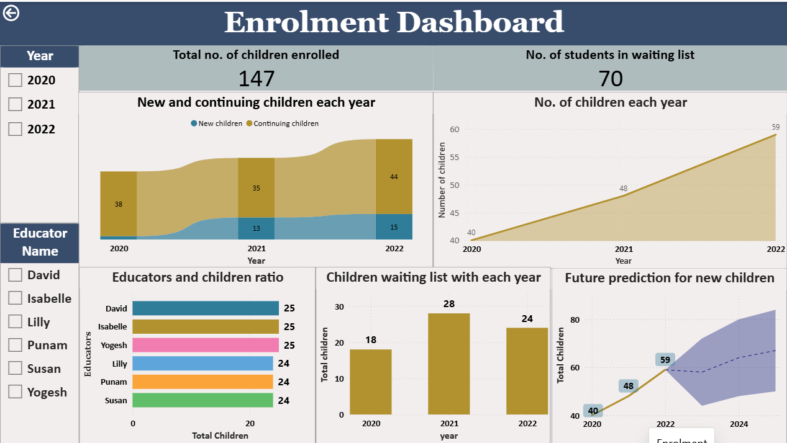

#Clapping Hands Childcare Centre – SQL Server Database & Power BI Dashboard

A Master of Information Technology capstone project (Federation University, Feb–Jun 2023) for a real client: an Adelaide childcare centre that needed data to decide whether, and how, to expand.


---

##Business problem
The centre ran on paper records and had no reliable view of enrolment growth, educator capacity or demand. Management needed evidence to decide whether to hire more educators and add classrooms.

##My role
**Data Analyst & Dashboard Designer** in a team of 3, working with Ankit Tyagi (Team Lead) and Sushmita Mahat. I:
- Gathered requirements with the client in weekly meetings and helped write 30+ user stories across 3 Agile/Scrum sprints
- Designed and built the Educator, Activity & Attendance and Enrolment dashboards
- Analysed the data and presented the findings and recommendations to the client

##Data and model
| Item |	Detail |
|---|---|
| Database	| Microsoft SQL Server: 10 related tables (children, parents, educators, enrolment, attendance, activities, ratings, waitlist, dietary requirements)|
| Records |	~28,000 across 3 years (2020–2022) |
|Data	| Realistic synthetic data built around the client's business rules (no real personal data) |

##Tools
Microsoft SQL Server (SSMS) · SQL · Power BI Desktop · DAX · Excel · Trello · MS Teams

##SQL analysis
`analysis_queries.sql` answers 8 business questions using joins, CTEs, `CASE`, and window functions (`LAG`, `RANK`, running totals). For example:
```sql
-- How fast is enrolment growing year on year?
WITH yearly AS (
    SELECT year, COUNT(DISTINCT child_id) AS children_enrolled
    FROM Enrolment
    GROUP BY year
)
SELECT year,
       children_enrolled,
       ROUND(100.0 * (children_enrolled - LAG(children_enrolled) OVER (ORDER BY year))
             / LAG(children_enrolled) OVER (ORDER BY year), 1) AS yoy_growth_pct
FROM yearly
ORDER BY year;
-- 2020: 40 | 2021: 48 (+20.0%) | 2022: 59 (+22.9%)
```
`database_schema.sql` contains the table definitions, primary keys and foreign keys.

##Key insights
| Finding |	Result |
|---|---|
| Enrolment growth, 2020–2022	| **+48%** (40 to 59 children) |
| Educator capacity (2022)	| **5 of 6 educators** at the 1:10 ratio limit |
| Waitlist (2020–2022) |	**70 children** |
| Forecast for 2025 without expansion |	**~68 children** |
| Child attendance rate |	**~76%**, steady each year |
| Happiest activities |	Playing with toys / outdoor play (~31% "cheerful") vs crafting (3%) |

## Recommendation
Hire **7 more educators** and add classroom capacity to meet waitlist demand while staying within the 1:10 educator-to-child ratio.

## Dashboards
| Enrolment	| Educator |
|---|---|
|  |	 |

| Activity & Attendance	| Children |
|---|---|
| 	|  |

**Features:** home page navigation, KPI cards, slicers, drill-downs, report-page tooltips, conditional formatting and a built-in trend forecast.

##Repository contents
| File	| What it is |
|---|---|
| `Clapping Hands_Dashboard.pbit`	| Power BI template. Open it in Power BI Desktop |
| `Childcare center dataset.xlsx`	| Source data (10 sheets) |
| `database_schema.sql`	| SQL Server table definitions and relationships |
| `analysis_queries.sql`	| 8 SQL analysis queries with results |
| `*.png`	Dashboard screenshots |
---
**Ravina Gaikwad** · Data Analyst · 
[LinkedIn] (https://linkedin.com/in/ravina-gaikwad-049399222)
